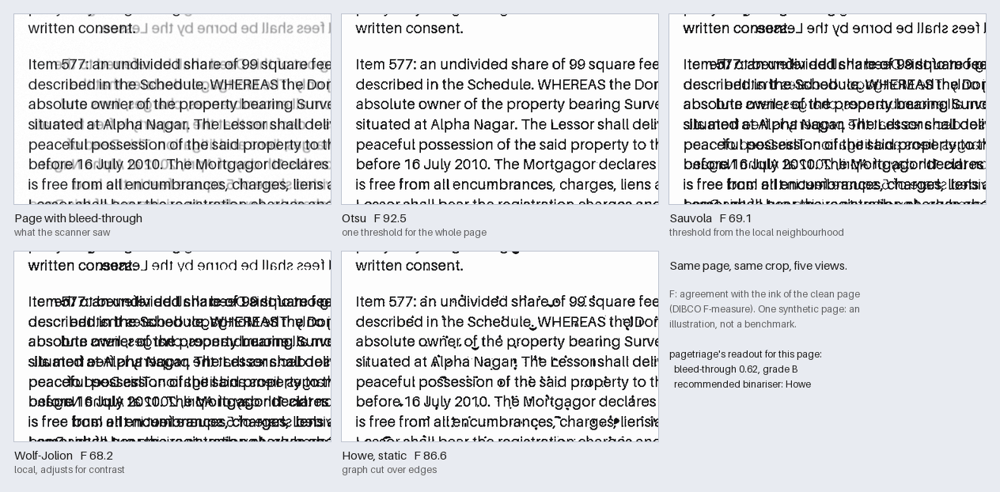
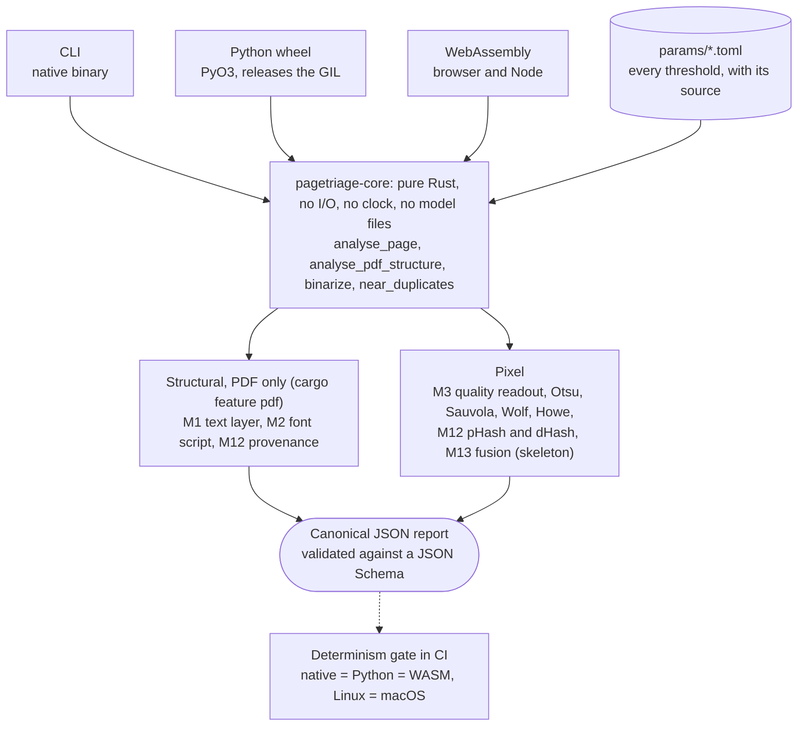
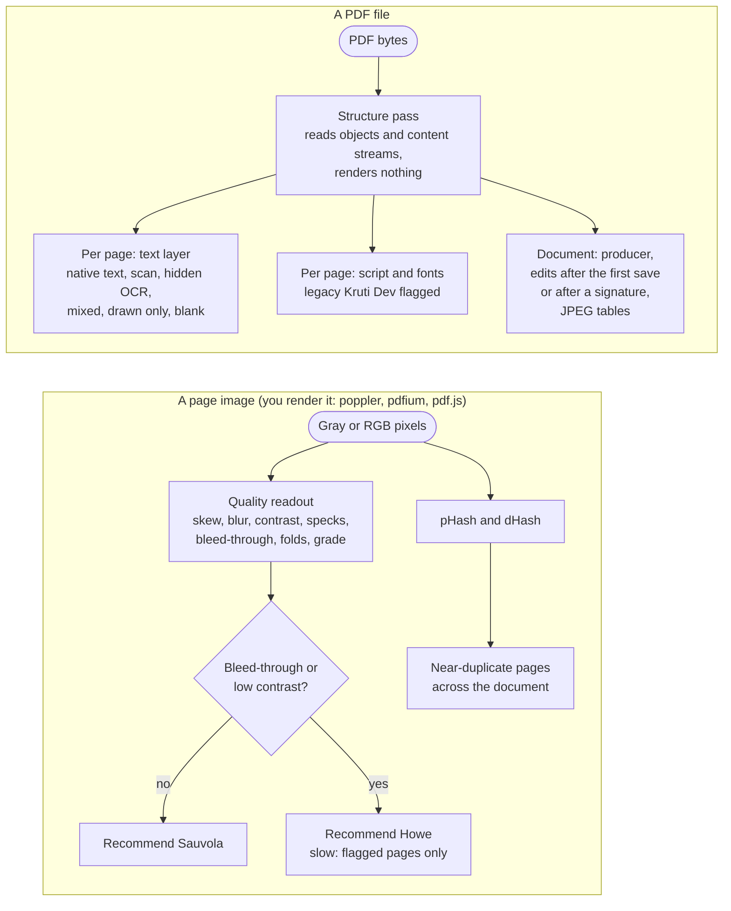

# pagetriage

Deterministic page analysis for scanned documents and PDFs: what is on each page, how bad the scan
is, and which pages to trust. Written in Rust, with no machine learning. It runs as a command-line
tool, as a Python module and in the browser, and gives the same bytes out on all three.

[](https://github.com/jtushar53/pagetriage/actions/workflows/ci.yml)
[](#licence)
[](rust-toolchain.toml)
[](#what-makes-it-different)
[](#quick-start)



*One synthetic page with show-through from the reverse side, the same crop under Otsu, Sauvola,
Wolf-Jolion and Howe (static mode), and what pagetriage says about the page. An illustration, not a
benchmark; the benchmark numbers are [below](#results-and-known-limits).*

**Status: early.** The PDF structure checks, the scan-quality readout, four binarisers and
near-duplicate detection are built and measured. Handwriting, stamps, signatures, thumb impressions
and the other pixel detectors are being built on branches and are not on `main`. See
[What works today](#what-works-today), [Results and known limits](#results-and-known-limits) and
the [roadmap](#roadmap).

A browser demo is being set up at <https://jtushar53.github.io/pagetriage/> (GitHub Pages, from
`site/`): the Rust core compiled to WebAssembly, analysing a dropped page image or PDF in the tab,
with nothing uploaded.

## Why this exists

Scanned legal documents, Indian property deeds in particular, tend to arrive as multi-generation
photocopies: skewed, with ink showing through from the other side, stamped, folded, and written in
English mixed with Devanagari. Before you spend OCR time or a model call on a page, you want to know
a few things.

- Does the PDF already carry a text layer, an invisible OCR layer under a scan, or nothing at all?
- Is that text in a legacy font that looks like Hindi on screen and copies out as Latin gibberish?
- How degraded is the scan, and which binarisation method will cope?
- Is this page a copy of an earlier one? Was the file edited after it was signed?

pagetriage answers these from the PDF structure and from the pixels, with fixed rules, and reports
the measurements behind each answer. It is a triage step, not an OCR engine: it does not extract
text.

## What makes it different

- **Same input, same bytes out.** The report is canonical JSON (sorted keys, floats rounded to six
  decimals). CI compares golden reports byte for byte on native, Python and WebAssembly, on Linux
  and macOS. Platform `libm` calls and hash maps are banned by `clippy.toml`, because they differ
  between platforms.
- **No model files.** No neural networks, no learned codebooks. Hand-designed features and fixed
  thresholds; the project rules cap any fitted coefficients at about 50 per detector, kept as
  readable TOML. Every threshold lives in `crates/pagetriage-core/params/*.toml` with a comment
  naming its source or "tuned on <set>".
- **It shows its work.** Text-layer verdicts and findings carry an evidence list: the named
  measurement, its value, the threshold, its contribution to the confidence, and where the threshold
  came from.
- **One core, three runtimes.** The same Rust crate builds the CLI, a Python wheel and a
  WebAssembly package (246 KB gzipped without the PDF parser, 625 KB with it). The core does no file
  or network I/O and never reads the clock.
- **The failures are written down.** Each detector has a docs page with measured results, a failure
  gallery, what it was tuned on, and the targets it missed.

## What works today

| Module | What it tells you | Status | Docs |
|---|---|---|---|
| M1 text layer | Per PDF page: real text, scan only, hidden OCR layer under a scan, mixed, drawn lines only, or blank. Reads the content stream, renders nothing | Built | [text_layer](docs/detectors/text_layer.md) |
| M2 font script | Script of each page's text, and a flag for legacy non-Unicode Indian fonts (Kruti Dev and others) whose text extracts as gibberish | Built | [font_script](docs/detectors/font_script.md) |
| M3 quality | Skew, blur, contrast, specks, bleed-through, fold lines, an overall grade, and which binariser to use | Built | [quality](docs/detectors/quality.md) |
| Binarisers | Otsu, Sauvola, Wolf-Jolion, and the Howe graph-cut method with automatic parameter tuning | Built | [binarize](docs/detectors/binarize.md) |
| Layout | Text lines, blocks and columns, with rulings and graphics set aside; groundwork for M4 and M5. Opt-in, checked on synthetic pages only | Built, opt-in | [layout](docs/detectors/layout.md) |
| M4 script | Script family of a scan: headline (Devanagari, Bengali, Gurmukhi), joined (Arabic script) or separate letters (Latin and the rest). Opt-in, checked on synthetic pages only | Built, opt-in | [script](docs/detectors/script.md) |
| M5 handwriting | Regions of handwriting among print, including form fill-ins. **Weak**: catches round cursive-like strokes in synthetic tests, misses block capitals, never seen real handwriting | Built, opt-in, weak | [handwriting](docs/detectors/handwriting.md) |
| M9 rulings | Tables (rows and columns), ruled lines, checkbox grids with ticks counted, and faint fold lines told from printed rules. Opt-in, checked on synthetic pages only | Built, opt-in | [rulings](docs/detectors/rulings.md) |
| M6 stamp and seal | Coloured rubber stamps and seals (circle, rectangle, double ring), with colour and shape. Needs a colour page; finds nothing in gray scans. Opt-in, synthetic checks only | Built, opt-in | [stamp](docs/detectors/stamp.md) |
| M7 signature | Wet signatures: isolated tangled strokes taller than text. Opt-in, synthetic checks only; tall cursive handwriting is also flagged | Built, opt-in | [signature](docs/detectors/signature.md) |
| M8 thumb impression | Dark ovals of fingerprint ridges, from orientation coherence, ridge period, ink density and size. Opt-in; misses faint and smudged prints; synthetic checks only | Built, opt-in, weak | [thumb](docs/detectors/thumb.md) |
| M12 redaction boxes | Solid dark rectangles in running text (pixels), and black or white boxes painted over text that is still in a PDF's content stream (white-out included). Opt-in, synthetic checks only | Built, opt-in | [redaction](docs/detectors/redaction.md) |
| M11 QR codes | QR codes from their finder patterns (not decoded). Opt-in, synthetic checks only | Built, opt-in | [qr](docs/detectors/qr.md) |
| M11 embossed seal | Blind-embossed circular seals, from the antisymmetry of their shading. **Basic**: 3 to 5 of 6 on rendered reliefs, 0 of 6 under sensor noise 4; opt-in, synthetic checks only | Built, opt-in, weak | [emboss](docs/detectors/emboss.md) |
| M11 registrar endorsement | A stamp, seal or signature in the same place on most pages of a document (a pass over the page reports: CLI `document`, `finish_document`). Synthetic checks only | Built, document level | [endorsement](docs/detectors/endorsement.md) |
| M10 page type | Text, text with annotations, form, table, photo, mixed, blank, stamp-paper cover, from the layout and the other detectors' findings. Runs with `layout`; synthetic checks only | Built, opt-in | [page_type](docs/detectors/page_type.md) |
| M13 consistency rules | Overlap and blank-page rules; `estamp_qr` and `stamp_paper_header` (unvalidated) built from other findings; optional per-kind calibration maps (none shipped) | Built, hand set | [fusion](docs/detectors/fusion.md) |
| M12 provenance | PDF producer, edits after the first save (incremental updates), edits after a signature, JPEG encoder tables | Built | [provenance](docs/detectors/provenance.md) |
| M12 near-duplicates | Perceptual hashes per page, and which pages repeat an earlier one | Built, with limits | [phash](docs/detectors/phash.md) |
| M10 blank page | Blank-page finding | Skeleton, known wrong on faded scans | [blank_page](docs/detectors/blank_page.md) |
| Extraction coverage | Text on the page that no text box (a PDF's text layer, hidden OCR included, or an OCR run's boxes) sits on. Opt-in, synthetic checks only | Built, opt-in | [coverage](docs/detectors/coverage.md) |
| Calibrated confidences | Confidences calibrated on labelled real pages (the fitting tool exists, the labelled data does not) | Not possible yet | [roadmap](#roadmap), [modules](docs/modules.md) |

## Quick start

Packages are not published to crates.io, PyPI or npm yet. Build from source; `rust-toolchain.toml`
selects Rust 1.98 and adds the WebAssembly target.

```sh
git clone https://github.com/jtushar53/pagetriage && cd pagetriage
cargo build --release -p pagetriage-cli
```

**Command line.** `analyse` reads PNG, JPEG, TIFF, PNM and BMP pages; `structure` reads PDFs.

```sh
target/release/pagetriage analyse page.png --pretty            # quality readout, hashes, findings
target/release/pagetriage structure file.pdf --pretty          # text layer, script, provenance
target/release/pagetriage duplicates page1.png page2.png ...   # near-duplicate pages, in page order
target/release/pagetriage schema                               # JSON Schema of the page report
target/release/pagetriage params                               # default detector thresholds, as TOML
```

`analyse` also takes `--dpi` (default 150), `--debug` for the raw feature values, `--detectors` to
run a subset, and `--params FILE` to merge a TOML file over the defaults. Without `--pretty` the
output is the compact canonical form that the determinism gate compares.

On a synthetic test page rotated counter-clockwise by atan(1/19), about 3 degrees
(`tests/golden/quality_inputs/quality_skew_p3.pgm`), the `quality` block of the report is:

```json
{
  "bleed_through": 0.0,
  "blur_laplacian_var": 61832.568976,
  "contrast_rms": 0.266227,
  "fold_lines": 0,
  "grade": "B",
  "photocopy_generation_est": { "confidence": 0.6, "value": 1 },
  "recommended_binarizer": "sauvola",
  "skew_deg": 3.05,
  "speckle_density": 0.0
}
```

`skew_deg` is positive when the text rises to the right (counter-clockwise); rotate by the negative
to straighten the page.

Page 2 of `tests/golden/pdf/scripts_legacy.pdf`, a synthetic PDF, uses a font named `KrutiDev010`.
An excerpt of what `pagetriage structure` reports for it:

```json
{
  "text_layer": { "state": "native_text", "reliable": false, "confidence": 0.99593 },
  "script": {
    "name": "Devanagari (legacy-encoded)",
    "legacy_encoded": true,
    "legacy_script": "devanagari",
    "fonts": [
      { "name": "KrutiDev010", "legacy_encoded": true, "legacy_name_match": "krutidev", "glyphs": 91 }
    ]
  }
}
```

The page has a text layer, and the report says it cannot be trusted: copying the text gives Latin
gibberish. The full report lists the evidence behind both verdicts.

**Python.** `analyse_page` returns one page report and releases the GIL, so a thread pool analyses
pages in parallel.

```sh
python3 -m venv .venv && source .venv/bin/activate
pip install maturin pillow
maturin develop --release -m crates/pagetriage-py/Cargo.toml
```

```python
import json
import pagetriage_py as pt
from PIL import Image

im = Image.open("page.png").convert("L")
gray, (width, height) = im.tobytes(), im.size

report = json.loads(pt.analyse_page(gray, width, height, dpi=150))
print(report["quality"]["skew_deg"], report["quality"]["recommended_binarizer"])

ink = pt.binarize(gray, width, height, "sauvola")      # bytes, 1 = ink, 0 = paper
structure = json.loads(pt.analyse_pdf_structure(open("file.pdf", "rb").read()))
print(structure["pages"][0]["text_layer"]["state"], structure["structure"]["tamper_signal"])
```

**Browser and Node.** Run `scripts/install-wasm-tools.sh` once; it installs the pinned
`wasm-bindgen` CLI and `wasm-opt` under `~/.local/pagetriage-tools` and prints the `PATH` line to
add. `PAGETRIAGE_WASM_FEATURES=pdf` adds the PDF parser, and with it `analyse_pdf_structure`.

```sh
PAGETRIAGE_WASM_FEATURES=pdf scripts/build-wasm.sh     # -> dist/wasm/web and dist/wasm/nodejs
```

```js
import init, { analyse_page, rgb_to_gray, analyse_pdf_structure } from "./dist/wasm/web/pagetriage.js";
await init();
const gray = rgb_to_gray(rgbBytes);                     // 3 bytes per pixel in, 1 byte out
const report = JSON.parse(analyse_page(gray, undefined, width, height, 150, undefined, "{}"));
console.log(report.quality.skew_deg, report.quality.recommended_binarizer);
```

## How it fits together



The hosts only move bytes. The structural layer sits behind the `pdf` cargo feature (it pulls in the
`lopdf` parser), so the pixel-only WebAssembly build stays small. Reports are validated against
`schema/pagetriage-0.1.schema.json` and `schema/pagetriage-structure-0.1.schema.json`, and a test
fails when the Rust types drift from the checked-in schema.

The crates are `pagetriage-core` (the analyser), `pagetriage-cli`, `pagetriage-py` and
`pagetriage-wasm`. `bench/` holds the dataset fetcher, the evaluation scripts and the synthetic
corpus generator; `tests/golden/` and `tests/determinism/` hold the synthetic golden inputs and the
cross-runtime runners.

## What happens to a PDF or a page



The structure pass never draws a page. Pixel analysis works on page images that you render yourself
(poppler, pdfium, pdf.js): the core has no rasteriser. A page report can take that page's structural
result as input, so both halves end up in one report.

## Results and known limits

Every number below comes from scripts in `bench/` ([commands](#reproduce-the-numbers)) and is
written up, with its protocol, in `docs/detectors/`. The last column says how far to trust it.

| What was measured | Result | How far to trust it |
|---|---|---|
| PDF text-layer state, 300 pages of a synthetic PDF corpus | 300 of 300 correct | Weak evidence for real PDFs: we wrote the corpus. Two thresholds were tuned on the odd-numbered documents; the other half (159 pages) scored 159 of 159, run once |
| Legacy Devanagari fonts, same corpus | 17 of 17 flagged, none flagged among the other 283 pages | Weak: same corpus, the font-name list was written from memory, no real Kruti Dev PDF has been tested |
| Skew: 82 held-out DIBCO pages, each rotated 12 ways (984 measurements) | Median error 0.05 degrees; 90th percentile 0.75; worst 26.5 | The median is sound. The tail is poor: 60 of 984 measurements are off by more than 1 degree, concentrated in a papyri set and short handwritten crops. DIBCO is not deed material |
| Howe binarisation, 20 images from DIBCO 2009 and 2010 | F-measure 94.0; the Howe 2013 paper's figures for the same images average 93.8 | Optimistic: the implementation's conventions were chosen on these images |
| Howe binarisation, DIBCO 2011, 16 images held out | F-measure 89.6; the paper reports 91.9 | **Misses our target** of being within 1.5 points of the paper. The gap comes from three pages with large dark regions; on the other 13 pages we score 92.9 against the paper's 92.5 |
| Other methods on DIBCO 2011 | Otsu 82.1, Sauvola 81.6, Wolf 84.7 | Same images, same scoring |
| Bleed-through score against hand labels | AUC 0.86 on the pages it was tuned on, 0.71 on held-out pages | Weak out of sample; the labels were made by eye from thumbnails |
| Speed, one A4 page at 150 dpi (1240 x 1754), one thread | Analysis about 70 to 90 ms a page: medians of 68, 76 and 88 ms over 24 synthetic pages in three runs. Rendering a page with poppler's `pdftoppm` adds about 25 ms in a batch, 40 ms for one page per process | Apple-silicon laptop, release build, through the Python binding; the two slower runs were on a machine busy with other jobs. Binarisers on the same page: Otsu 2 ms, Sauvola 11 ms, Wolf 21 ms, Howe static 1.1 s |
| Throughput, Python thread pool, same pages | 13 pages/s on 1 thread, 48 on 4, 90 on 8, 129 on 12 | Same busy machine; an earlier run on it reached 142 on 12 threads. `analyse_page` releases the GIL, so 12 threads give about 10 times one thread |

Known limits, beyond the table:

- **The binariser recommendation is a two-way choice** between Sauvola and Howe. On an evenly lit
  synthetic page with strong bleed-through (the figure at the top), a plain global threshold, Otsu,
  scored higher than Howe in static mode (F 92.5 against 86.6). On the real DIBCO 2011 pages the
  order is the other way round: Otsu 82.1, Howe 89.6.
- **Fold detection** found all 16 synthetic creases but raises false alarms on real DIBCO pages, and
  misses a crease dark enough to binarise as ink.
- **The photocopy-generation estimate** is experimental and not validated on real copies; its
  confidence is capped at 0.6.
- **Near-duplicate hashes** miss a copy moved by 3% of the page or more, or rotated by a couple of
  degrees, and never find a page scanned upside down. On made-up typed pages with an identical
  layout, 12% to 16% of distinct page pairs fall within the default 10-bit threshold.
- **No real Indian deed has been tested.** The PDF corpus is synthetic, and the deed-specific
  detectors (stamp-paper header, e-stamp QR code, registrar endorsement) are not on `main`.

## Large documents

The structure pass reads PDF objects and content streams without rendering, so its cost grows about
linearly with page count. Measured on synthetic PDFs on an Apple-silicon Mac, with `/usr/bin/time -l`
for peak memory; not on a real document:

| File | Result |
|---|---|
| 13,000-page scan with an invisible OCR layer (one JPEG per page), 655 MB, analysed whole | 1.5 to 1.9 s; peak memory 1.7 GB, about 2.6 times the file size |
| The same file split into 13 chunks of 1,000 pages with `qpdf --split-pages=1000` | Splitting takes 0.7 to 0.9 s; each 49 MB chunk analyses in 0.15 s with a peak of about 135 MB |
| 13,000 born-digital text pages, 22 MB, analysed whole | 1.1 s; peak memory 270 MB, twelve times the file size, because per-page bookkeeping dominates when the pages themselves are small |
| 13,000-page scan with a larger JPEG per page, 1.32 GB | Refused by default (`PDF is 1316826254 bytes; the limit is 1073741824`). With the limit raised: 3.7 s, peak memory 3.0 GB |

**Limits.** The structure pass accepts files up to 1 GiB and analyses up to 100,000 pages per file.
These are safety limits for untrusted input, not tuned numbers; they were 256 MB and 5,000 pages
until a 13,000-page file hit both. Past the page cap a file is analysed up to the cap and marked
`degraded`, with the warning `page tree cut short at 100000 pages or depth 48`; a larger file fails
with `PDF is N bytes; the limit is 1073741824`. Both can be changed with a TOML file:

```toml
# limits.toml
[limits]
max_pages = 200000
max_input_bytes = 4000000000
```

```sh
target/release/pagetriage structure --params limits.toml big.pdf > report.json
qpdf --split-pages=1000 big.pdf chunk.pdf          # or split first, to keep memory down
```

Memory is the practical bound, and the ratio to file size depends on the file. On the 655 MB scan
fixture peak memory was about 2.6 times the file size and on the 1.32 GB one about 2.3 times, so a
1 GiB scan of that kind needs roughly 3 GB; the 22 MB born-digital fixture used far more per byte,
because 13,000 pages of bookkeeping dominate when the pages themselves are small.

**Pixel work is the expensive part.** For 13,000 A4 pages at 150 dpi, analysis plus rendering is
about 20 to 25 minutes on one thread (roughly 100 ms a page, extrapolated). Analysis alone is about
100 seconds at 130 pages/s on 12 threads (extrapolated); parallel rendering was not measured. Howe
binarisation is far slower, about 50 seconds per A4 page in `dual` mode (extrapolated from 23 s per
megapixel), so run it only on the pages the quality readout flags. Near-duplicate search over 13,000
page hashes takes under 0.1 s. A browser tab has far less memory than a workstation, and the demo
page applies its own smaller caps: use the CLI or Python for large files.

## Reproduce the numbers

```sh
python3 -m venv .venv && source .venv/bin/activate
pip install maturin -r bench/requirements.txt
maturin develop --release -m crates/pagetriage-py/Cargo.toml

python -I bench/fetch.py                       # DIBCO sets, about 240 MB, size and SHA-256 checked
python -I bench/eval_binarize.py --method howe --howe-mode dual --sets dibco2011
python -I bench/skew_eval.py --data bench/data --sets heldout
python -I bench/synth/make_pdf_corpus.py       # 300 synthetic PDF pages with labels
python -I bench/structure_eval.py --corpus bench/data/synth_pdf --split all
python -I bench/phash_eval.py --data bench/data --synthetic 100
```

The datasets are not redistributed from this repository. Each protocol, including which images the
settings were tuned on, is in `docs/detectors/`.

## Roadmap

Module codes are defined in [docs/modules.md](docs/modules.md). Nothing is on `main` until it has
a docs page with a failure gallery, golden tests and a benchmark line, and a new detector first lands
opt-in so the default report and the golden files do not change. Status as of 2026-10-25.

<!-- Status vocabulary, one per row: Built | Built, with limits | Skeleton | In progress (branch) | Planned.
     Flip a row's Status cell when its branch merges; the "What works today" table above has the same rows. -->

| Module | What it will decide | Phase | Status |
|---|---|---|---|
| M1 text layer | Native text, scan, hidden OCR layer, mixed, vector only, empty | 1 | Built |
| M2 font script | Script from PDF fonts; legacy non-Unicode Indian fonts | 1 | Built |
| M3 quality | Skew, blur, contrast, specks, bleed-through, folds, grade, binariser choice | 1 | Built; one target missed (Howe on DIBCO 2011) |
| M12 provenance and hashes | Producer, incremental updates, edits after a signature, JPEG tables, near-duplicate pages | 1 | Built, with limits |
| M10 content type | Page and region typing (text, form, table, photo, blank) | 0 and later | Page typing built (synthetic checks only); region typing not built |
| M4 script from pixels | Script of a scanned page, without a text layer | 2 | In progress (branch) |
| M5 handwriting | Handwritten vs machine-printed text, filled-in blanks on forms | 2 | In progress (branch) |
| Extraction coverage | How much of the page the text layer or OCR actually covers | 2 | Built (synthetic checks only) |
| M6 stamps and seals | Rubber stamps and seals, by colour and by shape | 3 | In progress (branch) |
| M7 signatures | Wet signatures | 3 | In progress (branch) |
| M8 thumb impressions | Thumb and finger impressions, via ridge coherence and frequency | 3 | In progress (branch) |
| M9 rulings | Rulings, tables, checkbox grids, fold lines vs rules | 3 | In progress (branch) |
| M11 Indian deeds | Stamp-paper header, e-stamp QR code, registrar endorsement, embossed seal. Needs a small annotated set of real deed pages; no public set exists | 4 | All four built; the header and the embossed seal are the weakest; synthetic checks only, no real deed seen |
| M13 fusion and calibration | Calibrated confidences, abstention, cross-detector consistency | 5 | Log-odds sum and consistency rules built; calibration machinery built, no maps (no labelled data) |
| Release | PyPI, crates.io and npm packages; docs site; browser demo | 5 | Browser demo in progress; packages not started |

## Built on

pagetriage reuses the features of published methods and replaces their trained classifiers with
fixed rules, so expect lower numbers than the papers report where a paper used a classifier.

- N. R. Howe, "Document binarization with automatic parameter tuning", IJDAR 16:247-258, 2013,
  [doi:10.1007/s10032-012-0192-x](https://doi.org/10.1007/s10032-012-0192-x)
  ([author's manuscript](http://www.science.smith.edu/~nhowe/research/pubs/divseg-ijdar.pdf)). The
  Howe binariser is implemented from this text; its Tables 1 and 3 are the published numbers used in
  the comparison above.
- N. R. Howe, "A Laplacian energy for document binarization", ICDAR 2011, the method the 2013 paper tunes.
- N. Otsu, "A threshold selection method from gray-level histograms", IEEE Trans. SMC 9(1), 1979.
- J. Sauvola and M. Pietikäinen, "Adaptive document image binarization", Pattern Recognition 33(2), 2000.
- C. Wolf and J.-M. Jolion, 2004, for the Wolf-Jolion threshold (citation and formula recalled from
  memory, not yet re-checked).
- J. Canny, "A computational approach to edge detection", IEEE TPAMI 8(6), 1986.
- Y. Boykov and V. Kolmogorov, "An experimental comparison of min-cut/max-flow algorithms for
  energy minimization in vision", IEEE TPAMI 26(9), 2004.
- B. B. Chaudhuri and U. Pal, "Skew angle detection of digitized Indian script documents", IEEE TPAMI 19(2), 1997.
- ISO 32000-1:2008 and ISO 32000-2:2020 (PDF), for content streams, text render modes and incremental updates.

The full list is in [docs/REFERENCES.md](docs/REFERENCES.md). Some entries there are marked
unverified, which means the citation was recorded from memory and not yet re-checked.

## Develop

```sh
cargo fmt --all --check
cargo clippy --workspace --all-targets -- -D warnings
cargo test                          # core and CLI, including the golden snapshots and schema drift
scripts/install-wasm-tools.sh       # once: the pinned wasm-bindgen CLI and wasm-opt; add the PATH line it prints
scripts/determinism.sh              # native, Python and WASM against tests/golden (needs maturin, node)
```

The [project rules](CLAUDE.md) say what a change has to respect: no model files, thresholds in TOML
with their source, the determinism rules, and a docs page with a failure gallery per detector. A
golden-file diff is a behaviour change and is reviewed as one. Issues and pull requests are welcome.

## Data and privacy

Real document pages are never committed: deeds contain personal data. The golden inputs and every
sample in this repository are synthetic and generated by scripts. The benchmark datasets (DIBCO and
others) forbid redistribution or state no licence, so they are fetched at runtime into `bench/data/`,
which is gitignored.

## Licence

Licensed under either of [Apache License, Version 2.0](LICENSE-APACHE) or [MIT licence](LICENSE-MIT)
at your option. Unless you explicitly state otherwise, any contribution intentionally submitted for
inclusion in this project by you, as defined in the Apache-2.0 licence, shall be dual licensed as
above, without any additional terms or conditions.
